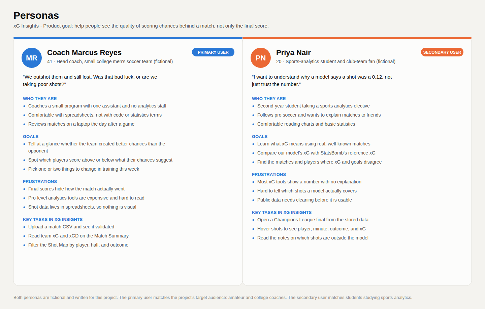
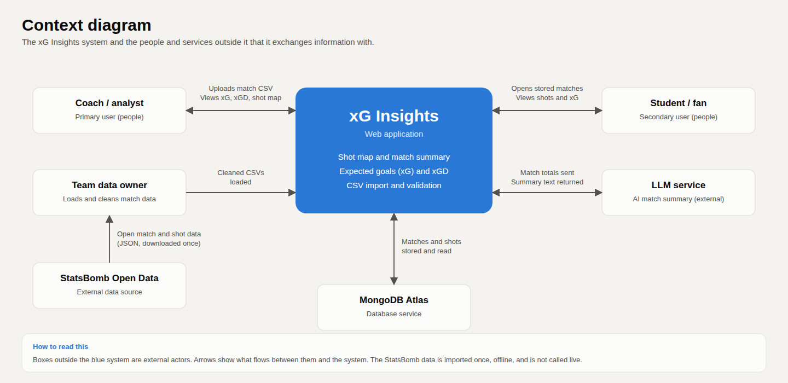
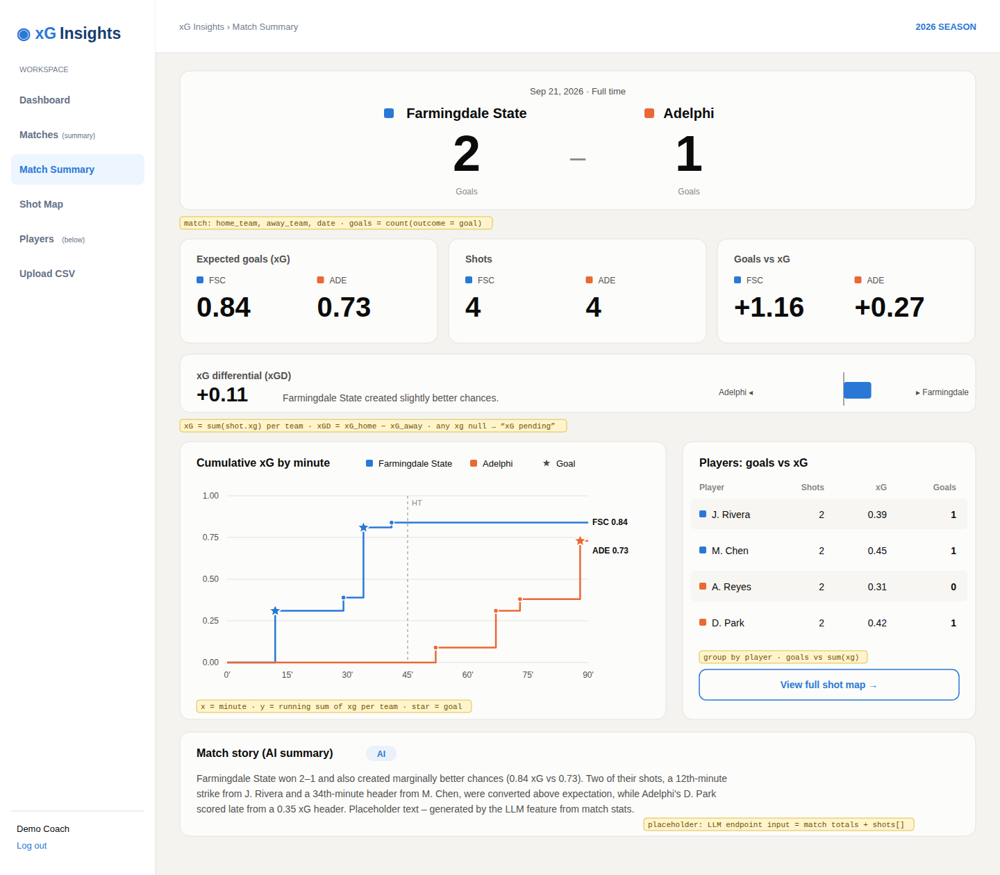
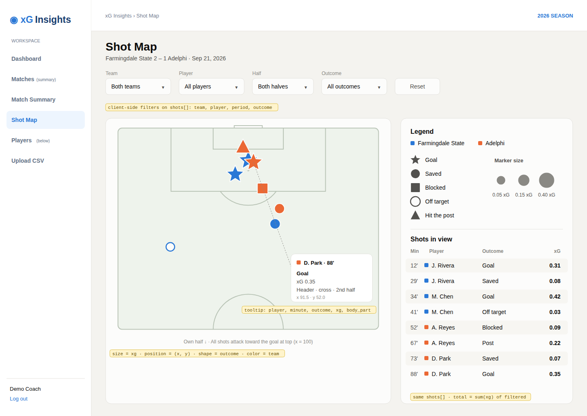
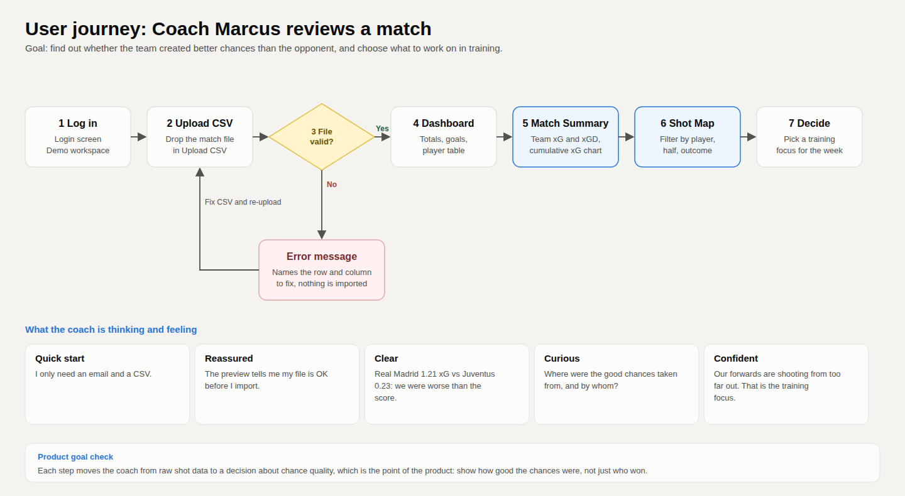

# xG Insights — development and CI/CD

React/Vite demo, Django REST API, and Python shot analytics. The existing
heuristic remains the application's xG model; the logistic-regression experiment
is offline and is not deployed. The original proposal, personas, and design
history are preserved below.

## Install and run locally

Prerequisites: **Python 3.12**, **Node.js 24**, npm, and Git. From the repository
root (Bash):

```bash
python -m venv Analytics/.venv
source Analytics/.venv/bin/activate
cd football-xg-backend
python -m pip install -r requirements.txt -r ../requirements.txt -r ../Analytics/requirements-ml.txt
cd ../frontend
npm ci
npm run dev
```

Open the local Vite address printed by the command. Choose **Explore the demo
workspace**; no real account is needed. Match Summary, Shot Map, filters, and CSV
preview/import run in browser memory using sample or uploaded data. Refreshing
resets the demo. Imported xG values are displayed; the frontend does not calculate
new xG or persist records to MongoDB. Demo login is not secure authentication.

For Windows PowerShell, run `py -3.12 -m venv Analytics/.venv`, then call
`.\Analytics\.venv\Scripts\python.exe` instead of activating the environment.
From the repository root, install with:

```powershell
Push-Location football-xg-backend
..\Analytics\.venv\Scripts\python.exe -m pip install -r requirements.txt -r ../requirements.txt -r ../Analytics/requirements-ml.txt
Pop-Location
Push-Location frontend
npm ci
npm run dev
Pop-Location
```

To run the API, use another terminal with the virtual environment active. The
normal Django development server requires a compatible local MongoDB instance
or your team's usable MongoDB URI for its migration check. Copy the backend's
`.env.example` to an ignored `.env` and configure it locally; never commit real
credentials. With MongoDB available:

```bash
cd football-xg-backend
python manage.py migrate
python manage.py runserver 127.0.0.1:8000
```

Database migration/Atlas connectivity is not established by the CI tests: the
current API tests use `SimpleTestCase` and do not require a database. For just the
currently stateless endpoints, a development-only server can run without MongoDB:

```bash
cd football-xg-backend
python -m django check --settings=config.settings
python -c 'from wsgiref.simple_server import make_server; from config.wsgi import application; make_server("127.0.0.1", 8000, application).serve_forever()'
```

Vite proxies `/api` to port 8000 locally. Check `GET /api/health/` and
`POST /api/xg/calculate/` with JSON
`{"x":85,"y":50,"body_part":"right_foot","outcome":"goal"}`. Health returns
`{"status":"ok"}`; the calculation returns numeric xG and `xg_status: "computed"`.
The AI summary is a placeholder; it is not a live LLM service.

## Automated checks

With the Python environment active, from the repository root:

```bash
python -m unittest discover -s Analytics -p 'test_*.py' -v
python -m Analytics.data_smoke_check
cd football-xg-backend
python manage.py check
python manage.py test api --verbosity 2
cd ../frontend
npm run test
npm run lint
npm run build -- --base=/Real-time-xG-engine/
```

Local validation: **51 analytics tests, 9 API tests, and 4 frontend helper tests
passed**, with no skipped tests. Lint/build passed. The data smoke check processed
429 shots: 247 numeric predictions, 182 outside-model shots, zero errors.
The new analytics acceptance scenarios in `Analytics/test_acceptance.py` cover
physical distance/angle, invalid coordinates, numeric xG, label/provider-xG
independence, and unsupported shots returning missing values rather than zero.
The frontend tests exercise existing visualization helpers, not full browser
acceptance. See the [story evidence and submission checklist](docs/capstone-ci-cd.md)
for verified PR approvals, remaining gaps, and the browser smoke-check scope.

## CI/CD and deployment

One workflow, [`.github/workflows/ci-cd.yml`](.github/workflows/ci-cd.yml), runs on
**every push** and **every pull request targeting main**. Its four jobs are:

1. **Setup** — select Python 3.12/Node 24 and verify manifests.
2. **Dependencies** — install/check Python dependencies and run frozen `npm ci`.
3. **Test** — install its own dependencies, scan secrets/history, run analytics
   acceptance/unit tests, dataset smoke check, Django tests, frontend helper
   tests/lint, and a Pages-compatible build. No failing command is ignored.
   Prerequisite failure also fails this required check instead of skipping it.
4. **Deploy** — only a successful **push to main** deploys the exact tested
   frontend artifact to GitHub Pages. Feature pushes and all PRs skip deployment.

Jobs run on separate machines: dependency caches save download time, but the
Test job still installs its dependencies. Ordinary jobs have read-only contents
permissions; only Deploy receives `pages: write` and `id-token: write`. Actions
are pinned to inspected commit SHAs. The workflow never uses `pull_request_target`
and never supplies production credentials to PR code.

**Pages hosts only the React demo. It does not host Django, MongoDB, Python xG
inference, or a real AI service.** The summary's unavailable message is expected
on Pages; sample data, map, dashboard, and CSV interaction remain functional.
No custom hosting token is required: deployment uses GitHub's short-lived
`GITHUB_TOKEN`/OIDC credentials, scoped to the Deploy job.

Administrator: enable Actions and set **Settings → Pages → Build and deployment →
Source: GitHub Actions**. After approved merge, the main push deploys the artifact.
Read the verified public URL from the Deploy job's `github-pages` environment and
test it while signed out before submitting. **No public deployment URL has been
verified yet.** For a local preview of the Pages build, run
`npm run preview -- --base=/Real-time-xG-engine/` in `frontend/` and open `/Real-time-xG-engine/` on that server.

## Branch protection, secrets, and team workflow

Work in a feature branch, open a PR linked to its story issues, request a teammate
review, and require the successful **Test** check before merging. Do not directly
push to main or bypass protection. **Do not require Test until a real workflow
run has first created and successfully completed it.** An administrator must
configure main's PR-only rule, one approval, Test check, and no bypasses; exact
settings and the activation order are in [the administration guide](docs/capstone-ci-cd.md#required-github-settings).
The existing protection settings could not be read through this environment's
GitHub API, so they are not claimed to be enabled.

Store hosting/backend credentials only in GitHub Actions/environment Secrets
(**Settings → Secrets and variables → Actions**), with production environments
restricted to main. Never place credentials in source, `VITE_*` variables, build
artifacts, screenshots, or PR logs. Everything embedded into a frontend build is
public. Local `.env` files remain ignored.

Run `bash scripts/scan-secrets.sh` on Linux x86_64 to install checksum-verified
Gitleaks 8.24.3 and scan reachable Git history plus tracked/unignored source.
It prints fully redacted findings and fails when a finding is detected. The
checked-in config retains default rules and permits only the raw StatsBomb
`key_pass_id` event-UUID format for the generic-key rule. See the audit in the
submission guide. If a real credential is found, revoke/rotate it immediately,
replace it with a secure secret binding, and coordinate history cleanup; deleting
a file or making a new commit does not revoke a leaked credential.

## AI assistance and personal verification

Codex assisted with this workflow, acceptance/helper tests, documentation, and
repository/evidence inspection. Earlier ML work also used Codex; the existing
analytics README records earlier Copilot/ChatGPT assistance. Actual mistakes
identified and corrected include the original experiment's output path being
able to overwrite its dataset and accepting padded match IDs that could defeat
match grouping. Regression tests for both were added before PR #31. The root
README had stale counts (29 analytics/8 API tests) and referred to an unmerged
frontend API module as if present; those statements are corrected here. Initial
Gitleaks detections of event UUIDs were investigated rather than reported as real
credential leaks or suppressed by excluding all data files. Browser validation also caught an incorrect local preview command
that omitted the build base path; the documented preview command now includes it.

The student must personally review/explain the code, reproduce tests locally,
verify course AI-disclosure rules, obtain genuine teammate approval, inspect the
remote CI run, test the public deployment and Kanban access while signed out, and
record the demonstration. Locally passing checks are not evidence of a green
GitHub Actions run or of completed database integration.

---

# CSC 325 Capstone Project Proposals

## Team Members

- Alejandro Pena Sanchez
- Michael Sookpaul
- Shayaan Bokhari
- Joseph Farah
- Rory Anderson
- Jason Portillo-Marte

## Application Type
Web Application

## APPROVED PROJECT: xG Insight: Soccer Chance Quality Analytics

**Status:** Approved by Prof. Moaath Alrajab

**Description:**
A web application that analyzes soccer shots and estimates how likely each shot was to result in a goal.

**Problem:**
Final scores do not always reflect which team created better scoring opportunities, and advanced expected-goals analytics can be difficult for casual users to access or understand.

**Target Audience:**
Soccer fans, amateur and college coaches, students studying sports analytics, and players interested in match analysis.

**Five Epics:**
1. Import and clean open soccer match and shot data.
2. Build an expected-goals model using factors such as shot distance, angle, body part, and shot type.
3. Display match shot maps and a timeline of expected-goals opportunities.
4. Create player pages comparing actual goals with expected goals.
5. Provide an interactive shot simulator that estimates scoring probability.

**Technologies/Services (confirmed course stack):**
- Python
- Django + Django REST Framework (backend/API)
- MongoDB (database)
- Figma (design/wireframing)
- GitHub (version control)
- Kanban via GitHub Projects (project management)
- Frontend framework: team's choice (web or mobile)
- AI/LLM-powered feature required by the course — not yet assigned to a specific epic; team needs to decide how it folds in (e.g., an LLM-generated natural-language match summary, or a Q&A feature answering questions about a team's stats)
- CHAT GPT/ CODEX 
---

## Other Proposals Considered (Not Selected)

### 1. Smart Bill Splitting Application

**Description:**
A web application that allows groups to scan a restaurant receipt, assign purchased items to individuals, calculate each person's share, and simplify repayment between friends or group members.

**Problem:**
Splitting bills can become confusing when people order different items, share purchases, or need to figure out exactly how much each person owes. This application would reduce mistakes and make it easier for people to pay back the correct amount.

**Target Audience:**
Friends, families, coworkers, teams, and other groups sharing restaurant or group expenses.

**Five Epics:**
1. Use OCR to extract items and prices from an uploaded receipt image.
2. Allow users to assign or claim individual receipt items.
3. Automatically calculate each person's subtotal and share of the tip.
4. Create shared sessions where multiple participants can join and claim items.
5. Generate each participant's final amount and provide payment-link options.

**Technologies/Services:**
Python, Reflex, SQLite, AWS Textract or another OCR service.

### 2. Auto Repair Shop Finder & Review Platform

**Description:**
A web application that helps drivers find and compare local repair shops based on services offered, vehicle specialization, price range, and customer ratings.

**Problem:**
Drivers often struggle to determine which repair shops are trustworthy, affordable, and experienced with their specific vehicle or repair need.

**Target Audience:**
Car owners, especially students, first-time drivers, and people unfamiliar with local repair shops.

**Five Epics:**
1. Search and filter shops by service type, location, price range, and vehicle make.
2. View detailed shop profiles with services, specialties, contact information, and ratings.
3. Submit reviews with separate ratings for honesty, price, quality, and turnaround time.
4. Compare multiple repair shops side by side.
5. Create user accounts and save favorite shops.

**Technologies/Services:**
Python, Reflex, SQLite, optional mapping/geocoding API.

---

## Original Preference Ranking (as submitted)

1. Smart Bill Splitting Application
2. xG Insight: Soccer Chance Quality Analytics
3. Auto Repair Shop Finder & Review Platform

## Why xG Insight Is Now the Project Moving Forward

Although the Smart Bill Splitting Application was the team's original first choice, Prof. Alrajab approved xG Insight: Soccer Chance Quality Analytics, and that is the project the team is building for the remainder of the semester. xG Insight solves a real gap for amateur and college-level soccer programs that don't have access to professional-grade analytics, and the project scope, five epics, and course-mandated tech stack (Django/DRF, MongoDB) are already locked in and in active development.

## Prototype

**Product Goal:** Help coaches, students, and fans see how good a team's scoring chances were, not just who won the match. xG Insights shows every shot on a map, estimates the expected goals (xG) of each shot, and compares the two teams.

**Figma design (public link):** [View the design in Figma](https://www.figma.com/design/iqBBDFFMNrrJnjMWofFVD1/xG-Insights-%E2%80%93-Coach-Frontend?node-id=56-163&t=cB48CgzTJUxRwzqc-0)

**Clickable prototype (public link):** [Open the interactive prototype](https://www.figma.com/proto/iqBBDFFMNrrJnjMWofFVD1/xG-Insights-%E2%80%93-Coach-Frontend?node-id=6-87&t=GI0EI4XA9EnrBKld-1&scaling=min-zoom&content-scaling=fixed&page-id=0%3A1)

The Figma file has the personas, context diagram, UI screens, and user journey below. Exported images are in `docs/prototype/`.

### Personas

**Primary user: Coach Marcus Reyes** (fictional)
- 41, head coach of a small college men's soccer team.
- Comfortable with spreadsheets, not with code or statistics terms.
- Goal: tell quickly whether the team created better chances than the opponent, and decide what to work on in training.
- Frustration: final scores hide how a match went, and professional analytics tools are expensive and hard to read.
- Main tasks: upload a match CSV, read each team's xG, and filter the shot map by player and half.

**Secondary user: Priya Nair** (fictional)
- 20, sports analytics student and club-team fan.
- Comfortable reading charts and basic statistics.
- Goal: learn what xG means using real matches, and find matches where xG and the score disagree.
- Frustration: most xG tools show a number with no explanation of what it covers.
- Main tasks: open a stored Champions League final, hover over shots for details, and see which shots the model does not cover.



### Context diagram

The system is xG Insights, a web application. The outside actors and what they exchange with it:

- **Coach / analyst:** uploads a match CSV and views xG, xG difference, and the shot map.
- **Student / fan:** opens stored matches and views shots and xG.
- **Team data owner:** loads the cleaned CSV files into the system.
- **StatsBomb Open Data:** supplies match and shot data to the team data owner (downloaded once, not called live).
- **MongoDB Atlas:** the database where matches and shots are stored and read.
- **LLM service:** receives match totals and returns the AI match summary text.



### UI screens

All screens were designed in Figma and built in React with the same sidebar layout.

1. **Login:** demo sign-in for the prototype.
2. **Coach Dashboard:** matches, goals, shots, xG, and a player table.
3. **Upload CSV:** drop a file, see it validated, preview the rows, then import.
4. **Match Summary:** score, each team's xG and xG difference, goals compared with xG, an xG timeline, and a player table.
5. **Shot Map:** a half pitch with every shot. Shape shows the outcome, color shows the team, and size shows the xG. Filters for match, team, player, half, and outcome.

Design choices that follow the Product Goal:
- A shot the model cannot score shows "–" or "No xG", never 0.00, so a missing value is not mistaken for a poor chance.
- Team xG totals are labeled "supported shots only" when some shots are outside the model.
- Marker shapes do not rely on color alone.




### UX flow: how the primary user reviews a match

Coach Marcus wants to know whether his team created better chances than the opponent.

1. Logs in.
2. Uploads the match CSV. The app checks the columns, the 0 to 100 coordinates, and the outcome values.
3. If the file is invalid, an error names the row and the problem, nothing is imported, and he fixes the file and uploads again.
4. Sees the totals on the Dashboard.
5. Opens Match Summary to compare the score with each team's xG.
6. Opens the Shot Map and filters by player or half to see where the chances came from.
7. Decides on a training focus, for example shooting from closer range.

Priya follows a shorter path: she opens a stored match, reads the Match Summary, hovers over shots on the map, and reads the note about shots outside the model.



---

## Architecture

xG Insights is a client-server web application with a layered backend.

- **Client:** a React + Vite single-page app in `frontend/`. It shows the screens, validates uploaded CSVs, and calculates filters and totals in the browser. PR #23 proposes a frontend API module but is still open; `frontend/src/api.js` is not in this checkout. The AI match summary component (`AIMatchSummary.jsx`) currently fetches its endpoint directly.
- **Server:** a Django REST Framework API in `football-xg-backend/`. It validates requests and returns JSON.
- **Analytics package:** `Analytics/` holds the shot geometry (distance, angle, penalty-box check) and the xG model. It is plain Python with no Django dependency, so it can be tested on its own and replaced later without changing the API.
- **Database:** MongoDB Atlas with two collections, `matchCollection` and `shotCollection`, linked by `match_id`. The CSVs define the intended records; this checkout does not provide an ingestion endpoint, and live Atlas contents/connectivity have not been verified.
- **Data pipeline:** `Analytics/Data/Data_Cleaning.py` turns StatsBomb JSON into clean CSV files in the shared shot format. This runs offline, not as part of the web app.

**Current flow:** the React app works on local CSV data. The Django API can calculate xG for a shot through `POST /api/xg/calculate/`, but the React app does not send shots to it yet.

**Planned flow:** the React app sends uploaded shots to the Django API, the API calls the analytics package to calculate xG, and the result is stored in MongoDB and returned to the browser as JSON.

**Shared shot format:** `id, match_id, player, team, minute, period, x, y, outcome, body_part, assist_type, xg`. Coordinates `x` and `y` run from 0 to 100 and shots attack toward `x = 100`. `xg` is empty (null) for a shot outside the model, and the API adds an `xg_status` of `computed` or `unsupported`.

**API endpoints:**
- `GET /api/health/` checks that the API is running. Built.
- `POST /api/xg/calculate/` validates a shot and returns its xG. Built.
- `GET /api/ai/match-summary/` returns the match summary text. Placeholder text for now; the LLM call is planned.
- `GET /api/matches/<id>/` returns a match with its shots. Planned.
- CSV upload endpoint that validates, calculates xG, and stores shots. Planned. For now, CSV files are validated and previewed in the browser only.

**Design decisions:**
- Matches and shots are separate collections, which matches the data pipeline output and lets xG be updated per shot.
- The xG model is a first heuristic for penalty-area shots. Shots it cannot score get `null`, not 0, so missing values are never shown as poor chances.

---

## Test Plan

The project uses four categories of test. Each can be run from the command line.

**1. Unit tests.** Check single functions in the analytics package: input checks, distance, angle, penalty-box check, and the xG model. There are now 51 analytics tests; see the current validation and acceptance evidence above.
- Run: `py -m unittest discover -s Analytics -p "test_*.py"`
- Examples: a shot at the penalty spot gives a distance of 11.0 m and an angle of about 36.8 degrees; a shot outside the box returns `None`, not 0; `x = 101` raises an error; the same shot as a goal or a save gets the same xG.

**2. Integration tests.** Check the API together with the analytics code: input validation, status codes, and xG returned or null. There are 9 API tests; see the current validation above.
- Run: `cd football-xg-backend` then `python manage.py test api`
- Examples: `POST /api/xg/calculate/` with `x = 101` returns HTTP 400; a valid in-box shot returns HTTP 200 with an `xg` between 0 and 1.

**3. Build and lint checks (frontend).** Check that the frontend compiles and has no lint errors.
- Run: `cd frontend` then `npm run lint` and `npm run build`
- Four automated visualization-helper tests now run with `npm run test`; full browser acceptance remains separate from these helper tests.

**4. System and acceptance tests (manual).** Check the whole workflow as a user would. The team runs these before each demo, using `PROTOTYPE_TESTING_CHECKLIST.md`.
- Upload a CSV with a missing column: the error names the column and nothing is imported.
- Upload a CSV with an invalid outcome: the error names the row and nothing is imported.
- Load the converted StatsBomb data (429 shots, 14 matches): 247 shots have an xG and 182 are marked outside the model.
- Open Match Summary for a match with unsupported shots: totals are labeled "supported shots only" and no shot shows 0.00.
- Shot Map: filter by player and half, then hover over a shot to see its player, minute, outcome, and xG.
- Acceptance: a user acting as the coach persona completes upload, Match Summary, and Shot Map without help and can say which team created the better chances.

**Done means:** the unit and integration tests pass, `npm run lint` and `npm run build` pass, and the manual checks are run and recorded as pass or fail before the demo.
