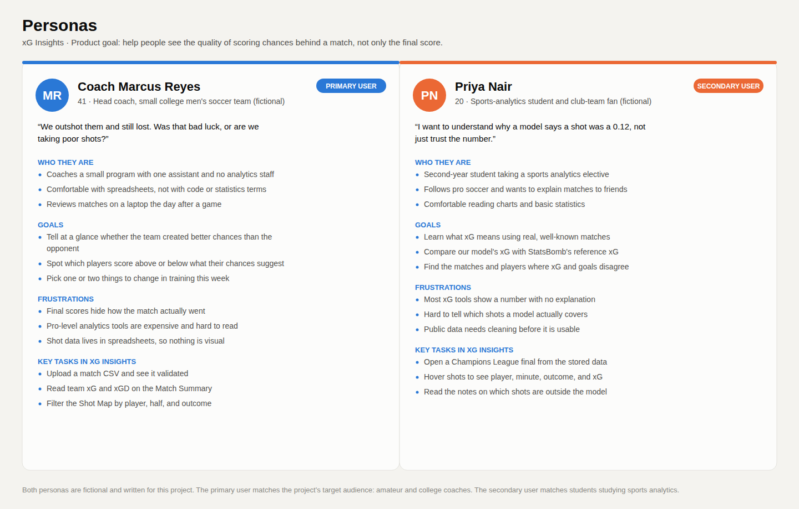
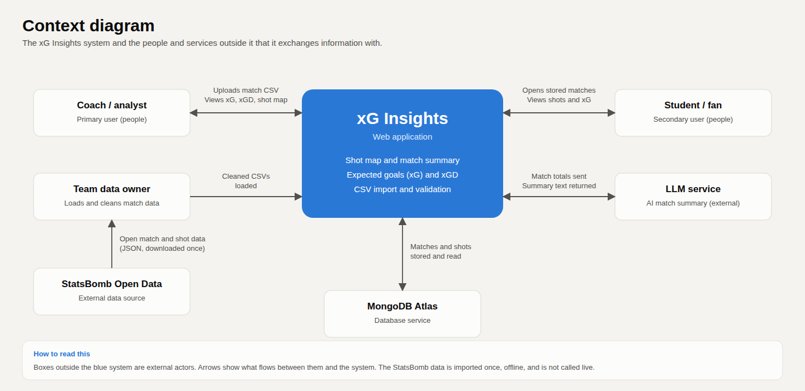
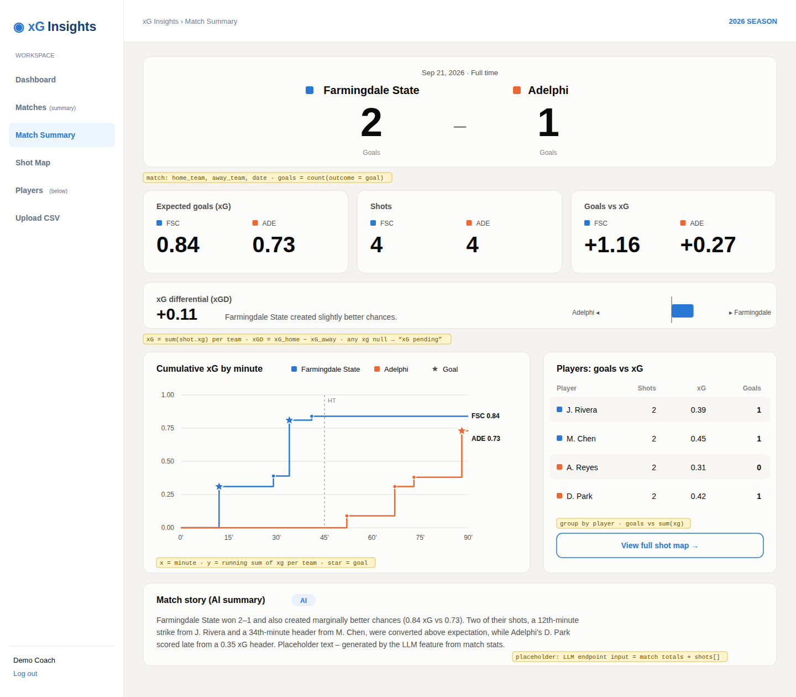
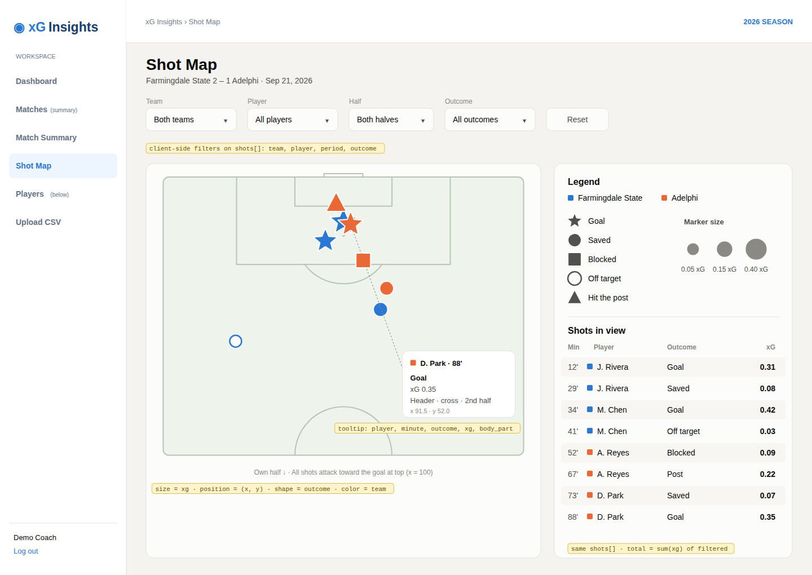
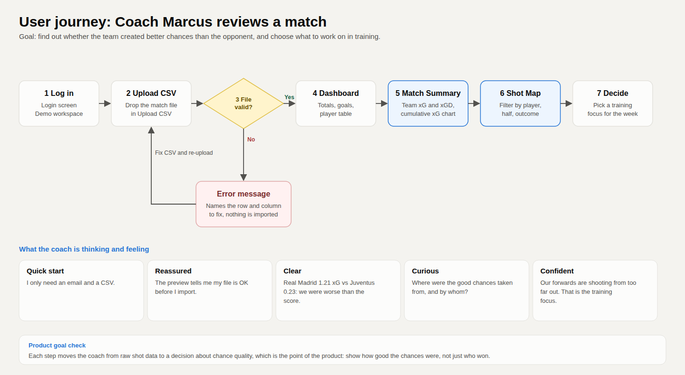

# CSC 325 Capstone Project Proposals

## Team Members

- Alejandro Pena Sanchez
- Michael Sookpaul
- Shayaan Bokhari
- Joseph Farah
- Rory Anderson
- Jason Portillo-Marte

## Application Type
Web Application

## APPROVED PROJECT: xG Insight: Soccer Chance Quality Analytics

**Status:** Approved by Prof. Moaath Alrajab

**Description:**
A web application that analyzes soccer shots and estimates how likely each shot was to result in a goal.

**Problem:**
Final scores do not always reflect which team created better scoring opportunities, and advanced expected-goals analytics can be difficult for casual users to access or understand.

**Target Audience:**
Soccer fans, amateur and college coaches, students studying sports analytics, and players interested in match analysis.

**Five Epics:**
1. Import and clean open soccer match and shot data.
2. Build an expected-goals model using factors such as shot distance, angle, body part, and shot type.
3. Display match shot maps and a timeline of expected-goals opportunities.
4. Create player pages comparing actual goals with expected goals.
5. Provide an interactive shot simulator that estimates scoring probability.

**Technologies/Services (confirmed course stack):**
- Python
- Django + Django REST Framework (backend/API)
- MongoDB (database)
- Figma (design/wireframing)
- GitHub (version control)
- Kanban via GitHub Projects (project management)
- Frontend framework: team's choice (web or mobile)
- AI/LLM-powered feature required by the course — not yet assigned to a specific epic; team needs to decide how it folds in (e.g., an LLM-generated natural-language match summary, or a Q&A feature answering questions about a team's stats)
- CHAT GPT/ CODEX 
---

## Other Proposals Considered (Not Selected)

### 1. Smart Bill Splitting Application

**Description:**
A web application that allows groups to scan a restaurant receipt, assign purchased items to individuals, calculate each person's share, and simplify repayment between friends or group members.

**Problem:**
Splitting bills can become confusing when people order different items, share purchases, or need to figure out exactly how much each person owes. This application would reduce mistakes and make it easier for people to pay back the correct amount.

**Target Audience:**
Friends, families, coworkers, teams, and other groups sharing restaurant or group expenses.

**Five Epics:**
1. Use OCR to extract items and prices from an uploaded receipt image.
2. Allow users to assign or claim individual receipt items.
3. Automatically calculate each person's subtotal and share of the tip.
4. Create shared sessions where multiple participants can join and claim items.
5. Generate each participant's final amount and provide payment-link options.

**Technologies/Services:**
Python, Reflex, SQLite, AWS Textract or another OCR service.

### 2. Auto Repair Shop Finder & Review Platform

**Description:**
A web application that helps drivers find and compare local repair shops based on services offered, vehicle specialization, price range, and customer ratings.

**Problem:**
Drivers often struggle to determine which repair shops are trustworthy, affordable, and experienced with their specific vehicle or repair need.

**Target Audience:**
Car owners, especially students, first-time drivers, and people unfamiliar with local repair shops.

**Five Epics:**
1. Search and filter shops by service type, location, price range, and vehicle make.
2. View detailed shop profiles with services, specialties, contact information, and ratings.
3. Submit reviews with separate ratings for honesty, price, quality, and turnaround time.
4. Compare multiple repair shops side by side.
5. Create user accounts and save favorite shops.

**Technologies/Services:**
Python, Reflex, SQLite, optional mapping/geocoding API.

---

## Original Preference Ranking (as submitted)

1. Smart Bill Splitting Application
2. xG Insight: Soccer Chance Quality Analytics
3. Auto Repair Shop Finder & Review Platform

## Why xG Insight Is Now the Project Moving Forward

Although the Smart Bill Splitting Application was the team's original first choice, Prof. Alrajab approved xG Insight: Soccer Chance Quality Analytics, and that is the project the team is building for the remainder of the semester. xG Insight solves a real gap for amateur and college-level soccer programs that don't have access to professional-grade analytics, and the project scope, five epics, and course-mandated tech stack (Django/DRF, MongoDB) are already locked in and in active development.

## Prototype

**Product Goal:** Help coaches, students, and fans see how good a team's scoring chances were, not just who won the match. xG Insights shows every shot on a map, estimates the expected goals (xG) of each shot, and compares the two teams.

**Figma prototype (public link):** [View the prototype in Figma](https://www.figma.com/design/iqBBDFFMNrrJnjMWofFVD1/xG-Insights-–-Coach-Frontend?node-id=0-1&p=f&t=iWBuF72z6uTGh0Od-0)

The Figma file has the personas, context diagram, UI screens, and user journey below. Exported images are in `docs/prototype/`.

### Personas

**Primary user: Coach Marcus Reyes** (fictional)
- 41, head coach of a small college men's soccer team.
- Comfortable with spreadsheets, not with code or statistics terms.
- Goal: tell quickly whether the team created better chances than the opponent, and decide what to work on in training.
- Frustration: final scores hide how a match went, and professional analytics tools are expensive and hard to read.
- Main tasks: upload a match CSV, read each team's xG, and filter the shot map by player and half.

**Secondary user: Priya Nair** (fictional)
- 20, sports analytics student and club-team fan.
- Comfortable reading charts and basic statistics.
- Goal: learn what xG means using real matches, and find matches where xG and the score disagree.
- Frustration: most xG tools show a number with no explanation of what it covers.
- Main tasks: open a stored Champions League final, hover over shots for details, and see which shots the model does not cover.

### Context diagram

The system is xG Insights, a web application. The outside actors and what they exchange with it:

- **Coach / analyst:** uploads a match CSV and views xG, xG difference, and the shot map.
- **Student / fan:** opens stored matches and views shots and xG.
- **Team data owner:** loads the cleaned CSV files into the system.
- **StatsBomb Open Data:** supplies match and shot data to the team data owner (downloaded once, not called live).
- **MongoDB Atlas:** the database where matches and shots are stored and read.
- **LLM service:** receives match totals and returns the AI match summary text.

### UI screens

All screens were designed in Figma and built in React with the same sidebar layout.

1. **Login:** demo sign-in for the prototype.
2. **Coach Dashboard:** matches, goals, shots, xG, and a player table.
3. **Upload CSV:** drop a file, see it validated, preview the rows, then import.
4. **Match Summary:** score, each team's xG and xG difference, goals compared with xG, an xG timeline, and a player table.
5. **Shot Map:** a half pitch with every shot. Shape shows the outcome, color shows the team, and size shows the xG. Filters for match, team, player, half, and outcome.

Design choices that follow the Product Goal:
- A shot the model cannot score shows "–" or "No xG", never 0.00, so a missing value is not mistaken for a poor chance.
- Team xG totals are labeled "supported shots only" when some shots are outside the model.
- Marker shapes do not rely on color alone.

### UX flow: how the primary user reviews a match

Coach Marcus wants to know whether his team created better chances than the opponent.

1. Logs in.
2. Uploads the match CSV. The app checks the columns, the 0 to 100 coordinates, and the outcome values.
3. If the file is invalid, an error names the row and the problem, nothing is imported, and he fixes the file and uploads again.
4. Sees the totals on the Dashboard.
5. Opens Match Summary to compare the score with each team's xG.
6. Opens the Shot Map and filters by player or half to see where the chances came from.
7. Decides on a training focus, for example shooting from closer range.

Priya follows a shorter path: she opens a stored match, reads the Match Summary, hovers over shots on the map, and reads the note about shots outside the model.

---

## Architecture

xG Insights is a client-server web application with a layered backend.

- **Client:** a React + Vite single-page app in `frontend/`. It shows the screens, validates uploaded CSVs, and calculates filters and totals in the browser. All backend calls go through `frontend/src/api.js`.
- **Server:** a Django REST Framework API in `football-xg-backend/`. It validates requests and returns JSON.
- **Analytics package:** `Analytics/` holds the shot geometry (distance, angle, penalty-box check) and the xG model. It is plain Python with no Django dependency, so it can be tested on its own and replaced later without changing the API.
- **Database:** MongoDB Atlas with two collections, `matchCollection` and `shotCollection`, linked by `match_id`.
- **Data pipeline:** `Analytics/Data/Data_Cleaning.py` turns StatsBomb JSON into clean CSV files in the shared shot format. This runs offline, not as part of the web app.

How a request flows: the React app sends a request to the Django API, the API calls the analytics package to calculate xG, and the result is stored in or read from MongoDB and returned to the browser as JSON.

**Shared shot format:** `id, match_id, player, team, minute, period, x, y, outcome, body_part, assist_type, xg`. Coordinates `x` and `y` run from 0 to 100 and shots attack toward `x = 100`. `xg` is empty (null) for a shot outside the model, and the API adds an `xg_status` of `calculated` or `unsupported`.

**API endpoints:**
- `GET /api/health/` checks that the API is running. Built.
- `POST /api/xg/calculate/` validates a shot and returns its xG. Built.
- `GET /api/ai/match-summary/` returns the match summary text. Placeholder text for now; the LLM call is planned.
- `GET /api/matches/<id>/` returns a match with its shots. Built.
- CSV upload endpoint that validates, calculates xG, and stores shots. Built.

**Design decisions:**
- Matches and shots are separate collections, which matches the data pipeline output and lets xG be updated per shot.
- The xG model is a first heuristic for penalty-area shots. Shots it cannot score get `null`, not 0, so missing values are never shown as poor chances.

---

## Test Plan

The project uses four categories of test. Each can be run from the command line.

**1. Unit tests.** Check single functions in the analytics package: input checks, distance, angle, penalty-box check, and the xG model. All passing.
- Run: `py -m unittest discover -s Analytics -p "test_*.py"`
- Examples: a shot at the penalty spot gives a distance of 11.0 m and an angle of about 36.8 degrees; a shot outside the box returns `None`, not 0; `x = 101` raises an error; the same shot as a goal or a save gets the same xG.

**2. Integration tests.** Check the API together with the analytics code: input validation, status codes, and xG returned or null. All passing.
- Run: `cd football-xg-backend` then `python manage.py test api`
- Examples: `POST /api/xg/calculate/` with `x = 101` returns HTTP 400; a valid in-box shot returns HTTP 200 with an `xg` between 0 and 1.

**3. Build and lint checks (frontend).** Check that the frontend compiles and has no lint errors.
- Run: `cd frontend` then `npm run lint` and `npm run build`
- The frontend has no automated unit tests yet, so the screens are covered by these checks and by category 4.

**4. System and acceptance tests (manual).** Check the whole workflow as a user would. The team runs these before each demo, using `PROTOTYPE_TESTING_CHECKLIST.md`.
- Upload a CSV with a missing column: the error names the column and nothing is imported.
- Upload a CSV with an invalid outcome: the error names the row and nothing is imported.
- Upload the converted StatsBomb data (429 shots, 14 matches): 247 shots get an xG and 182 are marked outside the model.
- Open Match Summary for a match with unsupported shots: totals are labeled "supported shots only" and no shot shows 0.00.
- Shot Map: filter by player and half, then hover over a shot to see its player, minute, outcome, and xG.
- Acceptance: a user acting as the coach persona completes upload, Match Summary, and Shot Map without help and can say which team created the better chances.

**Done means:** the unit and integration tests pass, `npm run lint` and `npm run build` pass, and the manual checks are run and recorded as pass or fail before the demo.
